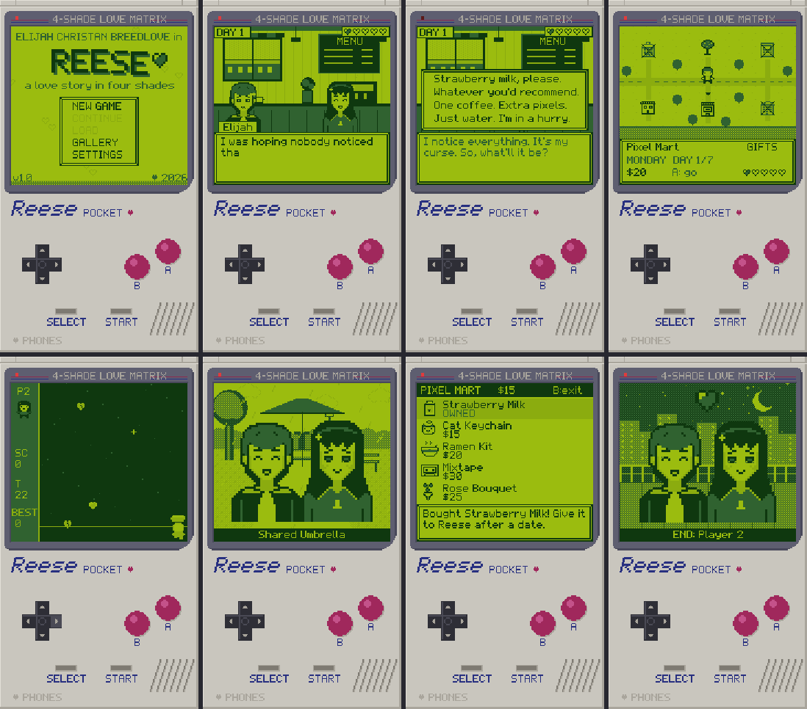

# ♥ REESE — a love story in four shades

An 8-bit dating sim / visual novel for Android that looks and plays like a classic
handheld: the whole phone screen becomes a pocket console with a 4-shade green LCD,
a working D-pad, A/B and START/SELECT buttons.

You play **Elijah Christan Breedlove**, a shy chiptune composer who has 7 days to get
brave enough to play his song at Open Mic Night — and to get to know **Reese**, the
witty barista who caught his demo tape. 5 endings.



---

## Contents
1. [Quick start: get the APK on your phone](#1-quick-start-get-the-apk-on-your-phone)
2. [Building it yourself](#2-building-it-yourself)
3. [How to play](#3-how-to-play)
4. [Editing the story (no code needed)](#4-editing-the-story-no-code-needed)
5. [The characters](#5-the-characters)
6. [The 5 endings](#6-the-5-endings-spoilers)
7. [Tech overview, palette and file tree](#7-tech-overview)
8. [Feature checklist](#8-feature-checklist)

---

## 1. Quick start: get the APK on your phone

**Option A: GitHub Actions (no computer needed)**
1. Push this project to a GitHub repository. The workflow in
   `.github/workflows/build-apk.yml` runs on every push.
2. Open the repo's **Actions** tab → the latest **Build APK** run → download the
   **Reese-apk** artifact (a zip containing `Reese.apk`).
3. *Easier on a phone:* create a tag that starts with `v` (for example `v1.0`, from
   GitHub's **Releases → Draft a new release** page). The workflow then attaches
   `Reese.apk` to that release, so you can download it straight from your phone's browser.

**Install it (sideload)**
1. On your phone, open the downloaded `Reese.apk`.
2. Android will ask to allow installs from that app (Chrome / Files). Tap
   **Settings → Allow from this source**, then go back and tap **Install**.
3. If Play Protect warns about an unknown developer, tap **More details → Install anyway**.
   (The app has **no permissions at all**: no internet, no ads, no accounts.)
4. Open **Reese** from your app drawer.

New builds are signed with the same key (`keystore/debug.keystore`), so you can install
updates over the old version and keep your saves.

## 2. Building it yourself

Requirements: **JDK 17+** and the **Android SDK** (Android Studio installs both).

```bash
# 1. Point Gradle at your Android SDK (Android Studio does this automatically)
echo "sdk.dir=/path/to/Android/Sdk" > local.properties

# 2. Run the tests (script check + a scripted playthrough to every ending)
./gradlew testDebugUnitTest

# 3. Build the APK
./gradlew assembleDebug
#    -> app/build/outputs/apk/debug/app-debug.apk

# 4. Install over USB (USB debugging on)
adb install -r app/build/outputs/apk/debug/app-debug.apk
```

Or open the folder in **Android Studio** and press ▶ Run.

The test run also writes screenshots of every screen, background and CG to
`app/build/screens/` and a WAV of the title theme, which is handy for checking art
changes without a phone.

## 3. How to play

| Control | What it does |
|---|---|
| **Tap the screen** or **A** | Advance text / pick the highlighted choice |
| **Tap a choice** | Pick it directly |
| **D-pad** | Move cursors; walk around the map; move the basket in the mini-game |
| **Hold B** | Fast-forward text (skip) |
| **SELECT** | Toggle auto-advance |
| **START** or Android **Back** | Pause menu: Save, Load, Backlog, Auto, Skip to choice, Settings, Quit |

You can also drag on the screen to move the basket in the mini-game. Physical gamepads
and keyboards work too (arrows/WASD, Z/Enter = A, X = B).

**Each day:** pick a place on the town map (closed places are crossed out), play the
date scene, and make 2–4 choices. Your choices raise or lower Reese's affection
(0–100, shown as 5 hearts) and set hidden flags that unlock special scenes later.
Visit **Pixel Mart** on the map to buy gifts; you get to offer one at the end of a date.
Elijah earns $10 a day, plus a bit from mini-game scores.

**Saving:** 3 save slots plus an autosave at the start of each day and each scene.
**Continue** on the title screen loads your most recent save. Endings don't overwrite
the autosave, so Continue after an ending lets you replay the finale.

## 4. Editing the story (no code needed)

All dialogue lives in **`app/src/main/assets/script/story.json`**. Edit it, rebuild,
done. (Run `./gradlew testDebugUnitTest` afterwards: it checks every label, scene,
expression, background and song name, and plays through to all 5 endings.)

### File layout
```jsonc
{
  "meta":      { "player_full_name": "Elijah Christan Breedlove", "player_name": "Elijah",
                 "nickname": "Eli", "nickname_at": 70, "start_affection": 20, ... },
  "locations": { "cafe": "Byte Cafe", ... },             // map names
  "days":      [ { "name": "MONDAY", "spots": { "cafe": "d1_cafe", "park": "d1_park" } },
                 ...,
                 { "name": "SUNDAY", "forced": "d7_finale" } ],  // forced = no map that day
  "shop":      [ { "id": "milk", "name": "Strawberry Milk", "price": 5, "desc": "..." } ],
  "endings":   [ { "id": "best", "title": "Player 2", "text": "..." } ],
  "scenes":    { "d1_cafe": [ ...commands... ], ... }
}
```

### Scene commands
A scene is a list of commands. One command can combine several keys (they run in this
order: `if` → effects → the action).

| Command | Meaning |
|---|---|
| `{"say":"reese","e":"happy","t":"Hi, {eli}!"}` | Reese speaks with an expression |
| `{"say":"eli","e":"nervous","t":"Uh..."}` | Elijah speaks; his portrait slides in beside the line (box label: "Elijah") |
| `{"say":"","t":"Narration..."}` | Narration (no name tag) |
| `{"say":"Kenji","t":"..."}` | Any other speaker, name only |
| `{"choice":[{"t":"Option","aff":5,"trait":"sweet","set":"flag","go":"label"}, ...]}` | 1–4 options. Each option can have `aff`, `set`, `unset`, `trait`, `coins`, `item`, `go`, and `if` (hide unless true) |
| `{"label":"x"}` / `{"go":"x"}` | Jump inside the scene (`"go":"scene:name"` jumps to another scene) |
| `{"call":"promise_ask"}` | Run another scene, then come back |
| `{"if":"aff>=50 & promised", ...}` | Only run this command if the condition is true |
| `{"aff":5}` `{"set":"flag"}` `{"unset":"flag"}` `{"trait":"goofy"}` `{"coins":10}` | Change state |
| `{"bg":"park","music":"park"}` | Change background / music (`"music":null` = silence) |
| `{"show":"blush"}` / `{"hide":true}` | Show Reese with an expression / hide her |
| `{"fx":"shake"}` `"flash"` `"rain"` `"norain"`, `{"sfx":"heart_up"}` | Effects |
| `{"title":"SUNDAY","sub":"Open Mic Night"}` | Full-screen title card |
| `{"cg":"umbrella"}` | Show a CG (also unlocks it in the Gallery) |
| `{"minigame":"hearts"}` | Play Heart Catch; the result is `score` |
| `{"giftprompt":true}` | Offer a gift if Elijah has one (runs scene `gift_<itemid>`) |
| `{"ending":"best"}` | Go to that ending |
| `{"end":true}` | End the scene (next day) |

**Text placeholders:** `{eli}` becomes "Elijah", or "Eli" once affection reaches
`nickname_at` (70). `{full}` = full name, `{score}`, `{coins}`.

**Conditions:** combine terms with `&` (and) and `|` (or):
`flag`, `!flag`, `aff>=75`, `aff<35`, `score>=30`, `day==3`, `coins>=20`, `gifts>=2`,
`trait:sweet` (Elijah's most-picked trait: `confident`, `sweet` or `goofy`),
`has:tape` (in inventory), `gave:roses`.

**Names you can use**
- Reese expressions: `neutral happy blush surprised sad annoyed`
- Elijah expressions: `neutral happy nervous determined`
- Backgrounds: `cafe park sunset arcade rooftop school room ramen stage station black white`
- Music: `title map cafe park arcade rooftop school room ramen brave sunset minigame ending sad credits`
- CGs: `first_meet umbrella ramen_night high_score fountain_song` (+ `end_<ending id>`)
- Sounds: `blip_eli blip_reese move select back heart_up heart_down catch bad buy gift start day shake door`

### Adding a new scene
1. Add `"my_scene": [ ... ]` under `"scenes"`.
2. Hook it up to a day: `"days"[n].spots` → `"park": "my_scene"`, or jump to it with
   `{"go":"scene:my_scene"}` / `{"call":"my_scene"}`.
3. Finish it with `{"giftprompt": true}` (optional) and `{"end": true}`.

### Changing art and music
- **Sprites** (portraits, items, map icons) are text pixel art in
  `app/src/main/assets/art/sprites.txt` (`.` = clear, `0`–`3` = lightest→darkest). You
  can edit that file directly, or edit the Python sources in `tools/` and run
  `python3 tools/gen_sprites.py` (needs Pillow only for the previews).
- **Backgrounds and CGs** are drawn in code: `core/Backgrounds.kt`.
- **Songs** are chord progressions + 8th-note melodies in `core/Synth.kt` (`SONGS`).

## 5. The characters

### Elijah Christan Breedlove (you)
- **Who:** 20, moved to the seaside town of Maple Bay six months ago. Kind, a little
  awkward around Reese at first, funny, and gets braver as the week goes on.
- **Backstory:** makes chiptune music on his late grandpa's old handheld. Grandpa's
  motto: *"Turn it up, kid. The world needs your noise."* He once coughed into a
  microphone in seventh grade and has had stage fright ever since.
- **Goal:** finish his album **BRAVE MODE** and play it live at the Neon Pixel Arcade's
  **Open Mic 8-Bit Night** on Sunday, the last day of the game.
- **Personality through choices:** every choice leans *confident*, *sweet* or *goofy*.
  Reese notices which one you pick most and reacts to it before the show.

### Reese
- **Personality:** witty, a little shy, notices everything, deflects with jokes.
- **Likes:** retro games, late-night ramen (*spicy miso, extra egg*, at Kenji's on 5th),
  strawberry milk, cassette tapes, rainy days, Bit the stray cat.
- **Dislikes:** cut flowers ("a countdown timer"), people who mock her drawings,
  wrong ramen orders.
- **Backstory:** grew up in her grandma's laundromat next to an old STAR LANCER arcade
  cabinet. When grandma passed, the arcade took the cabinet in, and Reese visits it.
  Works at Byte Café, studies art at Maple Bay College.
- **Secret (revealed on Day 5 if she trusts you):** she is **R.PIX**, the anonymous
  creator of *Lantern Fox*, a cult-hit homebrew game. It's missing one thing: music.
- **Her dilemma:** a game studio in Seattle has offered her a summer internship.

**Gifts:** Mixtape and Ramen Kit = **loves** · Cat Keychain and Strawberry Milk =
**likes** · Rose Bouquet = **dislikes** (worse if you heard what she said about cut flowers).

## 6. The 5 endings (spoilers!)

<details><summary>How to unlock each ending</summary>

| # | Ending | How |
|---|---|---|
| 1 | **Player 2** (Best) | Affection ≥ 75 on Sunday, don't break your promise, and confess on the rooftop |
| 2 | **New Game+** (Secret) | Like Best, plus: affection ≥ 90, **remembered her ramen order** (Thu café), **kept the fountain promise** (promise on Wed, go to the park on Sat), **learned her secret** (Fri rooftop or park), **scored 30+ in Heart Catch**, and gave a **loved gift** (Mixtape or Ramen Kit) |
| 3 | **Save File** (Long distance) | Promise to meet her Saturday, then don't show up (go to the café/arcade instead), with affection ≥ 55 |
| 4 | **Co-op Mode** (Friends) | Affection 35–74, or stay quiet on the rooftop |
| 5 | **Missed Connection** | Affection below 35 by Sunday: Reese isn't there |

A route to the secret ending: Mon café → Tue arcade (score 30+) → Wed park (make the
promise) → Thu café (spicy miso, extra egg) → Fri rooftop → Sat park, while buying the
Ramen Kit and Mixtape at Pixel Mart and picking the warmest options.
</details>

## 7. Tech overview

**Engine choice: Kotlin + Android Canvas.** A tiny custom engine instead of Godot means
no export templates and no extra runtime, so the APK is under 1 MB and the GitHub
Actions build is just `./gradlew assembleDebug`. All the game logic (`core/`) is plain
Kotlin with no Android imports, so the same code runs in JVM unit tests that play the
whole game and render screenshots.

- **Resolution:** a 180×320 console canvas (the 160×144 "LCD" + the console body),
  scaled up by a whole number with nearest-neighbor filtering. On a 1080×1920 phone
  that's exactly ×6, and pixels stay crisp. A faint LCD grid is drawn when the scale is
  ×4 or more.
- **Portrait mode**, Android 8.0+ (API 26), fixed 60 Hz logic.
- **Audio:** a home-made Game Boy-style synth (2 pulse channels, a 4-bit triangle wave
  channel, LFSR noise drums, plus an effects voice) streamed through `AudioTrack`.
  All 15 songs and 16 sound effects are generated in code.
- **Saves:** JSON files in the app's private storage (`save_auto/1/2/3.json`,
  `settings.json`, `gallery.json`), written atomically.
- **Offline:** no permissions in the manifest at all.

### Palette (19 colors)
| Screen (4 shades × 4 selectable palettes) | |
|---|---|
| **CLASSIC** (default) | `#9BBC0F` `#8BAC0F` `#306230` `#0F380F` |
| POCKET | `#C4CFA1` `#8B956D` `#4D533C` `#1F1F1F` |
| SWEETHEART | `#FFE4EC` `#F29BB8` `#A34A72` `#3D1530` |
| MIDNIGHT | `#E3EEC0` `#8FB3A8` `#4A6A8A` `#1E2244` |

| Console body | |
|---|---|
| Body / shadow / highlight | `#C9C6BE` `#A9A59C` `#E3E0D8` |
| Screen bezel / bezel shadow | `#5E5E70` `#48485A` |
| D-pad / highlight | `#2E2E36` `#4A4A55` |
| A·B buttons / highlight / pressed | `#A0285C` `#C4528A` `#7A1A44` |
| Logo navy, stripe, LED, slots | `#283080` `#8C2850` `#E03C3C` `#7E7A72` |

At any moment the screen shows 4 shades + 15 body colors = **19 colors**.

### File tree
```
Reese/
├── .github/workflows/build-apk.yml   CI: test + build + upload APK (+ release on v* tags)
├── app/
│   ├── build.gradle.kts
│   └── src/
│       ├── main/
│       │   ├── AndroidManifest.xml   portrait, no permissions
│       │   ├── assets/
│       │   │   ├── script/story.json ★ all dialogue, days, shop, endings
│       │   │   └── art/sprites.txt   all sprites as text pixel art
│       │   ├── java/com/reese/game/
│       │   │   ├── MainActivity.kt   activity, render view, touch, audio thread
│       │   │   └── core/             pure Kotlin game (no Android imports)
│       │   │       ├── Game.kt         console shell, input, screen stack, saves
│       │   │       ├── Screens.kt      title, scene, map, shop, mini-game, menus, endings
│       │   │       ├── Story.kt        script engine, conditions, game state
│       │   │       ├── Backgrounds.kt  10 locations + 10 CGs drawn in code
│       │   │       ├── Synth.kt        chiptune synth, songs, sound effects
│       │   │       ├── Art.kt Scr.kt Font.kt Json.kt
│       │   └── res/                  icon, theme
│       └── test/java/com/reese/game/
│           ├── StoryTest.kt          script lint + playthrough to all 5 endings
│           └── ScreenshotTest.kt     drives the real UI, saves PNG screenshots
├── tools/                            Python sources for the pixel art (gen_sprites.py)
├── keystore/debug.keystore           shared debug signing key (password "android")
└── docs/preview.png
```

## 8. Feature checklist

Checked items are covered by the automated tests (`./gradlew testDebugUnitTest`), which
play the real script to every ending and drive the real UI. The game has not been run on
a physical phone yet. The Android layer (touch, audio output, back button) is
the part that still needs a check on a device.

**Tech**
- [x] Kotlin + Android Canvas, Android 8.0+ (API 26), portrait
- [x] Low-res canvas (160×144 LCD inside 180×320), integer nearest-neighbor scaling (×6 at 1080×1920)
- [x] Fully offline: no internet permission, no ads, no accounts
- [x] Build instructions + GitHub Actions workflow that outputs a signed APK

**Art (Game Boy style)**
- [x] Palette defined up front (19 colors; 4 selectable screen palettes)
- [x] Every sprite is pixel art from code/text; no placeholder boxes
- [x] Reese 32×48 portrait: neutral, happy, blushing, surprised, sad, annoyed + blink frame for each
- [x] Elijah 32×48 portrait: neutral, happy, nervous, determined + blink; shown beside his lines
- [x] Elijah overworld sprite (walk cycles down/up/side) on the town map
- [x] Backgrounds: café, park, arcade, rooftop at night, school hallway (+ sunset park, bedroom, ramen shop, stage, train station)
- [x] Retro text box, typewriter effect, blinking ▼, pixel font, heart meter in the corner

**Audio**
- [x] Chiptune music for every location (15 songs, generated in code)
- [x] Text blips (low for Elijah, high for Reese), menu select/move, heart up/down jingles
- [x] Music and SFX volume settings

**Story & characters**
- [x] Intro introduces Elijah Christan Breedlove (full name on the title screen, intro, performance, endings, credits) and how he meets Reese
- [x] Dialogue boxes label him "Elijah"; Reese switches to "Eli" when affection ≥ 70
- [x] Elijah's backstory and goal (BRAVE MODE / Open Mic) drive the plot
- [x] Reese: personality, likes, dislikes, backstory, secret (R.PIX) revealed later
- [x] Reese reacts to earlier choices (remembered orders, promise, dominant trait, gifts)
- [x] Wholesome / PG

**Gameplay**
- [x] 7 days: pick a location → date scene with 2–4 choices → affection +/-
- [x] Affection 0–100 shown as 5 hearts (half-heart steps)
- [x] Hidden flags (ramen order, promise kept/broken, secret, high score, ...) unlock special scenes
- [x] Mini-game: Heart Catch on arcade dates; score changes affection
- [x] Gift shop with 5 items (loves / likes / dislikes)
- [x] **5 endings**: Best, Secret, Long Distance, Friends, Missed Connection

**Systems**
- [x] Title screen with an animated logo: New Game, Continue, Load, Gallery, Settings
- [x] 3 save slots + autosave, saved locally
- [x] Gallery of unlockable CGs and endings (10)
- [x] Skip (hold B / pause menu), auto-advance (SELECT), text speed, backlog
- [x] Tap to advance, tap choices; Android back button opens the pause menu
